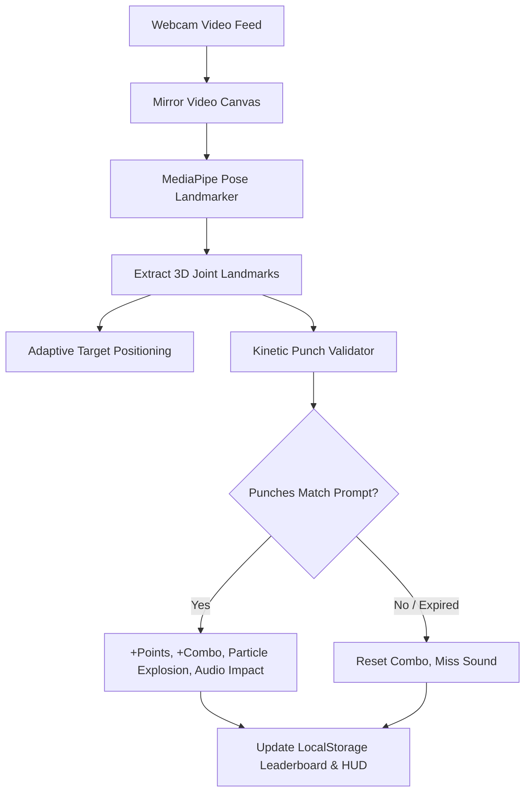

# Just Box 🥊 — Motion Boxing Game

[](https://github.com/NikhilForge/boxing-game)
[](https://github.com/NikhilForge/boxing-game)
[](https://github.com/NikhilForge/boxing-game)
[](LICENSE)

> **Just Box** is an interactive, motion-controlled boxing rhythm arcade game inspired by *Just Dance* and VR rhythm games. Using real-time computer vision and pose tracking, players throw actual boxing combinations at moving target zones to score points, build combos, and climb the leaderboard — all without needing external sensors or controllers!

---

## ⚡ Highlights

- 📱 **Play Anywhere (Desktop & Mobile)**: Runs smoothly in mobile browsers (iOS Safari, Android Chrome) and desktop browsers (Chrome, Edge, Safari) with zero app installations.
- 🎯 **Dynamic Body-Anchored Targets**: Target zones automatically scale and follow your physical shoulders, chin, and stance in real time — whether you are tall, short, close, or far from the camera.
- 🧠 **True Biomechanical Motion Tracking**: 
  - **3D Z-Depth Punching**: Tracks forward fist thrust toward the lens, eliminating 2D foreshortening misses.
  - **Kinetic Speed Validation**: Differentiates between an active punch strike and resting guard hands to eliminate false-positive hits.
  - **Joint Angle Geometry**: Recognizes hooks and uppercuts via cosine elbow angles and vertical velocity vectors.
- 🏆 **Hall of Champions (Leaderboard)**: Complete persistent scoreboard tracking rank, fighter name, high score, maximum combo, and round date.
- 🥊 **Interactive Glove HUD**: Glowing on-screen boxing gloves (Cyan **L** for Left, Gold **R** for Right) show your fists tracking in real-time.
- 🔊 **Synthesized Web Audio**: Built-in punch impacts, crowd atmospheres, countdown beeps, and boxing bells powered by the Web Audio API without bulky external sound files.
- 🐍 **Dual Runtime**: Play instantly via the browser Web App or execute natively on your PC via Python & OpenCV.

---

## 🥊 The Boxing Moves

The game prompts combinations using standard boxing numbering (Orthodox stance):

| Number | Move Name | Hand | Technique & Trajectory |
| :---: | :--- | :---: | :--- |
| **1** | **Jab** | Left (Lead) | Quick straight punch extending toward the target |
| **2** | **Cross** | Right (Rear) | Powerful straight punch driving forward from the chin |
| **3** | **Lead Hook** | Left (Lead) | Horizontal arc punch with a bent elbow swinging into the jaw |
| **4** | **Rear Hook** | Right (Rear) | Power horizontal swing curving across into the chin |
| **5** | **Lead Uppercut** | Left (Lead) | Upward vertical drive rising from chest to chin |
| **6** | **Rear Uppercut** | Right (Rear) | Power upward scoop driving up beneath the chin |

> 📖 **Want to master your form?** Check out the comprehensive **[Player & Trainer Guide](GUIDE.md)** for detailed stance breakdowns, technique tips, and motion-tracking mechanics.

---

## 🚀 Quickstart & How to Play

### Option 1: Universal Web App (Recommended ⭐)

Play directly in your browser on **Mobile** or **Desktop**:

1. Clone the repository:
   ```bash
   git clone https://github.com/NikhilForge/boxing-game.git
   cd boxing-game
   ```

2. Start a local server (or simply double-click `index.html`):
   ```bash
   python -m http.server 8000
   ```

3. Open **`http://localhost:8000`** in your browser.
4. Click **"Start Game"**, allow camera permissions, and stand 5–7 feet away so your upper body is in view.

#### 🌐 Free 1-Click Hosting for Mobile Play:
- **GitHub Pages**: Go to your repository settings ➔ **Pages** ➔ set source to `main` branch ➔ save. Your free HTTPS mobile game link will be live in seconds!
- **Vercel / Netlify**: Connect this repo or drag and drop the folder for instant global HTTPS hosting.

---

### Option 2: Python Desktop Mode

If you prefer to run the OpenCV / YOLOv8 desktop version:

1. Create and activate a Python virtual environment:
   ```bash
   python -m venv venv
   # Windows:
   .\venv\Scripts\activate
   # macOS / Linux:
   source venv/bin/activate
   ```

2. Install the dependencies:
   ```bash
   pip install -r requirements.txt
   ```

3. Run the desktop application:
   ```bash
   python main.py
   ```
   - Press **`q`** at any time to exit.
   - Press **`r`** on the Game Over screen to start a new round.

---

## 🕹️ Game Controls & Settings

- **Round Duration**:
  - **30s (Quick)** — High-intensity sprint
  - **60s (Standard)** — Classic boxing round
  - **90s (Pro)** — Endurance workout test
- **Difficulty**: Adjusts the target approach speed (Easy: `3.0s`, Medium: `2.2s`, Hard: `1.5s`).
- **Scoring**: Base 100 points multiplied by your active combo streak (`Score += 100 × Combo`).
- **Audio Toggle**: Mute or unmute synthesized sound effects with the HUD speaker icon.
- **Scoreboard**: Click **🏆 Scores** anytime to view your top 10 rankings or clear score history.

---

## 🛠️ Tech Stack & Architecture



| Layer | Technologies |
| :--- | :--- |
| **Frontend UI** | HTML5, CSS3 (Glassmorphism, CSS Grid, Flexbox), Google Fonts (Orbitron, Outfit) |
| **Rendering** | HTML5 Canvas 2D with particle physics & dynamic motion tracking |
| **Pose AI (Web)** | `@mediapipe/pose` (in-browser WebAssembly & WebGL acceleration) |
| **Pose AI (Desktop)** | Ultralytics YOLOv8-pose (`yolov8n-pose.pt`) |
| **Audio** | Web Audio API (real-time procedural sound synthesizer) |
| **Persistence** | Browser `localStorage` (Hall of Champions leaderboard) |

---

## 💡 Tips for Maximum Accuracy

1. **Camera Framing**: Stand far enough back so your head, shoulders, and hands are visible inside the camera frame.
2. **Lighting**: Ensure even lighting on your face and upper body to avoid shadow jitter.
3. **Guard Stance**: Return to your guard position between punches — punches are registered when your fist accelerates out toward the target!

---

## 📄 License

This project is licensed under the [MIT License](LICENSE). Contributions, issues, and feature requests are welcome!
